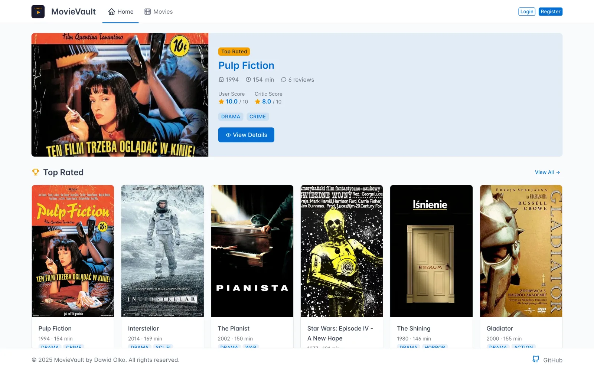
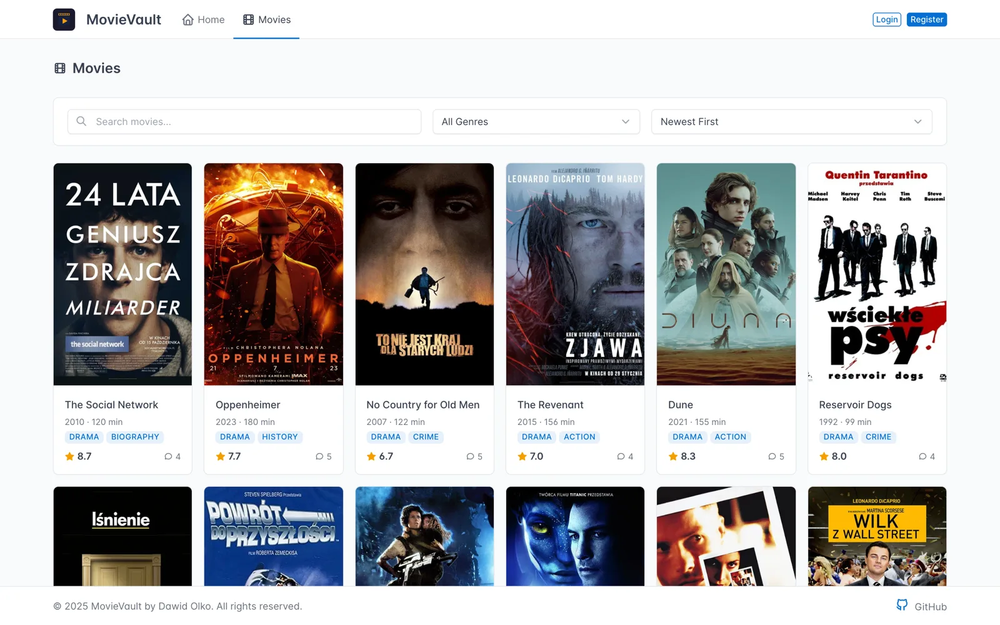
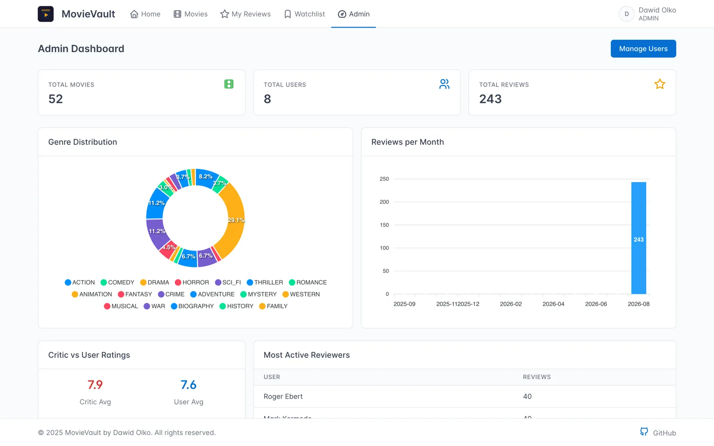
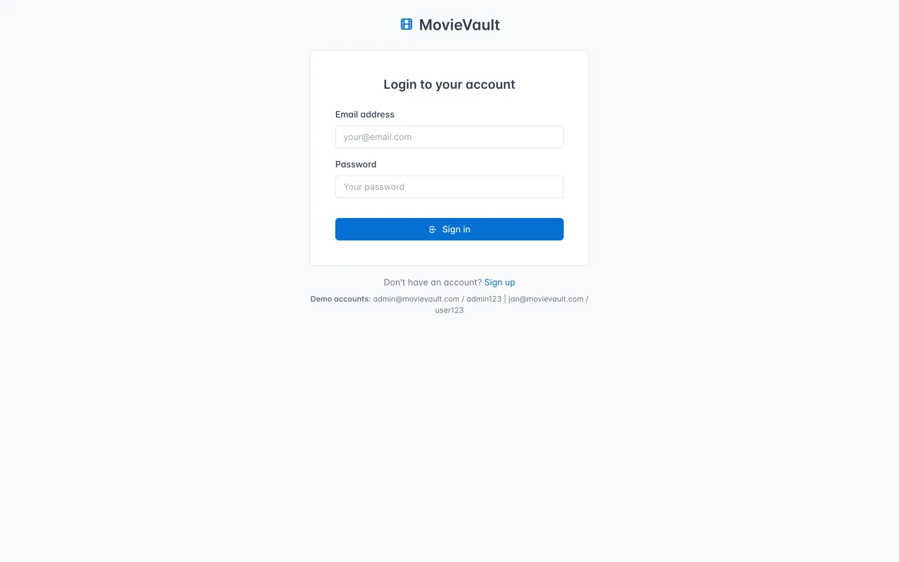
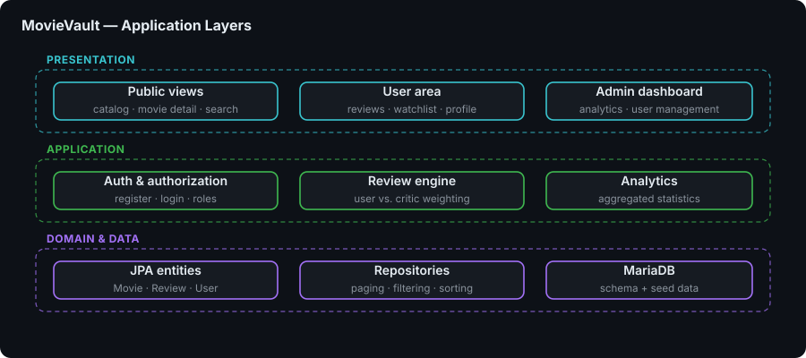
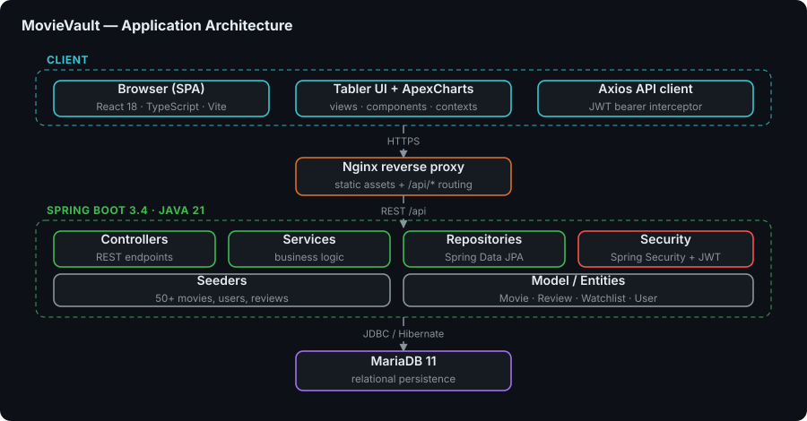

# MovieVault

> 🚀 **Full-Stack Movie Review Platform** - Browse, rate and review movies with a complete admin analytics suite

**MovieVault** is a full-stack movie review platform inspired by IMDb and Filmweb. Users can browse a catalogue of movies, write and rate reviews, curate a personal watchlist, and explore detailed platform statistics. Critic reviews are weighted differently from regular user reviews, giving the rating system an editorial dimension.

The project demonstrates a production-shaped **Spring Boot 3** REST API secured with JWT, a **React 18 + TypeScript** single-page frontend, and a **MariaDB** persistence layer — the whole stack containerized and orchestrated with Docker Compose behind an Nginx reverse proxy.


---

## 🎯 Key Features

- 🎬 **Movie Catalogue** — Browse and search 50+ movies with real TMDB posters, paginated and filterable
- 🔍 **Filtering & Sorting** — Filter by genre, sort by rating, release date or title
- 🔐 **JWT Authentication** — User registration and login secured with Spring Security and JSON Web Tokens
- ⭐ **Reviews & Ratings** — Write reviews and rate movies on a 1-10 scale
- 👍 **Review Likes** — Like and unlike reviews written by other users
- 🏅 **Critic Reviews** — Reviews from critic accounts are weighted differently from regular user reviews
- 📌 **Personal Watchlist** — Add and remove movies from a private watchlist
- 👤 **User Profiles** — Editable profile with avatar upload
- 🌗 **Dark / Light Theme** — Theme toggle persisted across sessions
- 📊 **Admin Analytics** — Dashboard with ApexCharts-powered charts and platform statistics
- 🛡️ **Admin User Management** — Change user roles and delete accounts

---

## 🖼️ Screenshots

| Home — featured & top rated | Movie catalog |
|---|---|
| [](docs/screenshots/home.webp) | [](docs/screenshots/movies.webp) |

| Admin dashboard — analytics | Sign in |
|---|---|
| [](docs/screenshots/admin-dashboard.webp) | [](docs/screenshots/login.webp) |

> Captured from the running Docker stack with the bundled seed data (52 movies, 8 users, 243 reviews).

---

## 🏗️ Architecture

### Application Layer



### Application Architecture



---

## 🧩 Modules / Services

| Service | Description | Stack |
|---|---|---|
| `movievault-frontend` | React SPA served by Nginx, also reverse-proxies API traffic | React 18, TypeScript, Vite, Nginx |
| `movievault-backend` | REST API, authentication, business logic and database seeding | Java 21, Spring Boot 3.4, Spring Security, JPA |
| `movievault-db` | Relational data store with a health-checked startup gate | MariaDB 11 |

---

## 🛠️ Technology Stack

### Frontend

- **React 18** with **TypeScript** — component-based SPA
- **Vite 5** — dev server and production bundler
- **Tabler UI** (`@tabler/core`) and **React Bootstrap** — UI component layer
- **ApexCharts** (`react-apexcharts`) — admin analytics charts
- **React Router 7** — client-side routing
- **Axios** — HTTP client for the REST API
- **Day.js** — date formatting
- **Jest** + **React Testing Library** — component tests

### Backend

- **Java 21** with **Spring Boot 3.4**
- **Spring Security** + **JJWT** — stateless JWT authentication
- **Spring Data JPA** / **Hibernate** — persistence layer
- **Spring Boot Actuator** — health and runtime endpoints
- **Spring Boot Mail** — outgoing mail support
- **Lombok** — boilerplate reduction
- **MySQL Connector/J** — MariaDB driver

### Infrastructure

- **MariaDB 11** — relational database with a Docker healthcheck
- **Docker** & **Docker Compose** — multi-service orchestration
- **Nginx** — static file serving and API reverse proxy
- **Multi-stage Docker builds** — slim runtime images for both services

---

## 🚀 Getting Started

### Prerequisites

- **Docker Desktop** (Docker Engine + Docker Compose)
- For local development without Docker: **JDK 21**, **Maven**, **Node.js 18+**, and a running **MariaDB/MySQL** instance

### 1. Clone the Repository

```bash
git clone https://github.com/dawidolko/MovieVault-Project-SpringBoot-React.git
cd MovieVault-Project-SpringBoot-React
```

### 2. Install Dependencies

Docker handles all dependencies automatically. For a local (non-Docker) setup:

```bash
# Backend
cd backend
./mvnw clean install

# Frontend
cd ../frontend
npm install
```

### 3. Run

The recommended path is Docker Compose — it starts the database, backend and frontend together:

```bash
docker compose up --build -d
```

The app is then available at **http://localhost** (the backend API is exposed on **http://localhost:8080**, the database on port **3307**).

Running locally without Docker:

```bash
# Terminal 1 — Backend (http://localhost:8080)
cd backend
./mvnw spring-boot:run

# Terminal 2 — Frontend (http://localhost:5173)
cd frontend
npm run dev
```

Useful frontend scripts: `npm run build`, `npm run lint`, `npm run preview`, `npm run format`, `npm test`.

### Demo Accounts

The backend seeds demo data on first startup (`APP_DB_SEED=true`):

| Role | Email | Password |
|------|-------|----------|
| Admin | admin@movievault.com | admin123 |
| Critic | roger@movievault.com | critic123 |
| Critic | mark@movievault.com | critic123 |
| User | jan@movievault.com | user123 |
| User | anna@movievault.com | user123 |

---

## 🔌 API Endpoints

| Method | Endpoint | Description |
|--------|----------|-------------|
| POST | `/api/auth/login` | Login |
| POST | `/api/auth/register` | Register |
| GET | `/api/movies` | List movies (paginated, filterable) |
| GET | `/api/movies/{id}` | Movie details |
| GET | `/api/movies/featured` | Featured movies |
| GET | `/api/reviews/movie/{id}` | Reviews for a movie |
| POST | `/api/reviews` | Create review |
| GET | `/api/watchlist` | User's watchlist |
| POST | `/api/watchlist` | Add to watchlist |
| GET | `/api/admin/analytics/*` | Admin analytics |
| GET | `/api/admin/users` | Admin user list |

---

## 📁 Project Structure

```
MovieVault-Project-SpringBoot-React/
├── 📁 backend/                       # Spring Boot REST API
│   ├── src/main/java/com/movievault/
│   │   ├── config/                   # Application configuration
│   │   ├── controller/               # REST endpoints
│   │   ├── dto/                      # Request/response payloads
│   │   ├── model/                    # JPA entities
│   │   ├── repository/               # Spring Data repositories
│   │   ├── security/                 # JWT filters and auth setup
│   │   ├── seed/                     # Database seeders (demo data)
│   │   └── service/                  # Business logic
│   ├── src/main/resources/           # Config, avatars, static assets
│   └── pom.xml                       # Maven build definition
├── 📁 frontend/                      # React + TypeScript SPA
│   └── src/
│       ├── assets/                   # Images and static assets
│       ├── components/               # Reusable UI components
│       ├── contexts/                 # React context providers
│       ├── hooks/                    # Custom React hooks
│       ├── layouts/                  # Page layout shells
│       ├── services/                 # API client layer
│       ├── utils/                    # Helpers
│       └── views/                    # Admin / Auth / Public / User pages
├── 📁 docs/diagrams/                 # Architecture diagrams (SVG)
├── 📁 .tools/docker/                 # Docker build assets
├── 🐳 docker-compose.yml             # Service orchestration
└── 📖 README.md                      # Project documentation
```

---

## 📄 License

This project is open source and available under the MIT License.

---

## 👨‍💻 Author

Created by **[Dawid Olko](https://github.com/dawidolko)**

- **Website** — [dawidolko.pl](https://dawidolko.pl/)
- **LinkedIn** — [@dawidolko](https://www.linkedin.com/in/dawidolko/)
